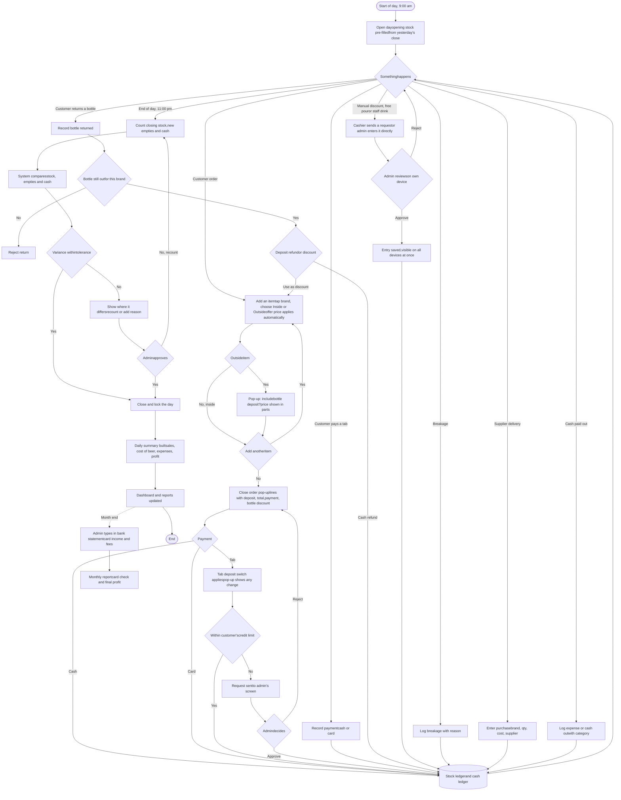
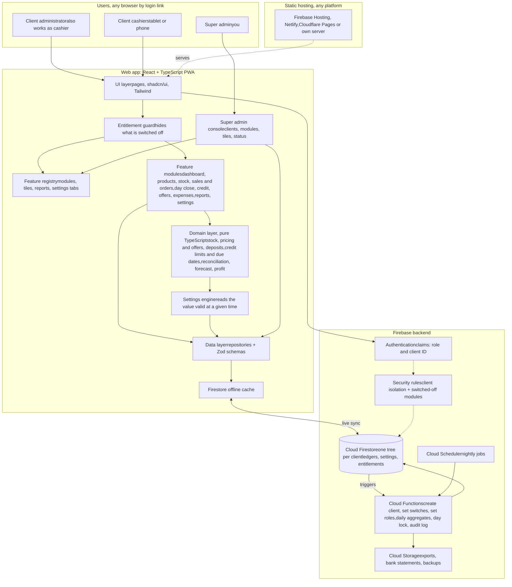
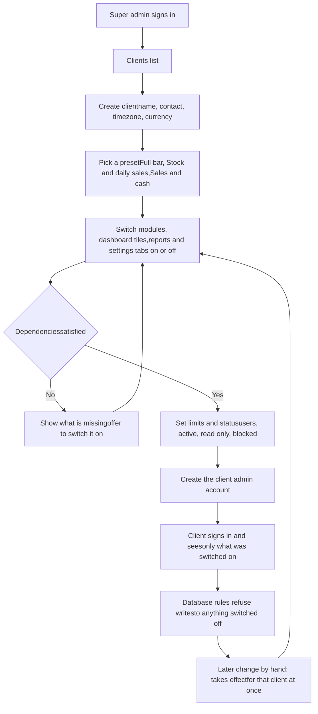
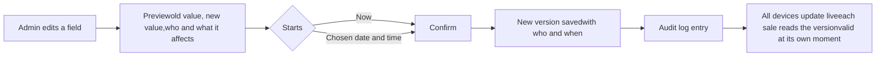

Restaurant & bar inventory · build blueprint · version 7

# Bar Ledger Blueprint

A way to reconcile sales without bills, diagrams, the data model, a Settings page, a Super Admin console for several clients, hosting advice, and a master prompt for Claude Code Desktop. Version 7 is final: every question is answered, cashiers can tick or untick the deposit in the pop-up, and the prompt matches all answers.

[1 · No-bill workaround](#workaround) [2 · Flowchart](#flow) [3 · Architecture](#arch) [4 · Super Admin](#super) [5 · Hosting](#hosting) [6 · Data model](#data) [7 · Settings page](#settings) [8 · Reports & algorithms](#ideas) [9 · Claude Code prompt](#prompt) [10 · Answers & open points](#questions)

The tricky part

## Reconcile sales without a bill updated

At the end of each day the system checks three things against each other: **stock**, **empty bottles** and **cash**. Outside customers take their bottle with them and bring it back later for the deposit, so the empties check counts returns as well as bottles drunk inside. Daily monitoring is cash only. Card money is checked once a month against the bank statement. If a daily check disagrees, the system says which one and by how much. This whole section is one module set. A client who only needs stock and daily sales can have it switched off (see the Super Admin section).

### Stock what left the fridge

Units out = opening + received − closing. Every unit out must be explained by a recorded sale, staff drink, free pour or breakage.

### Empties what stayed in the bar

Expected new empties = inside sales + staff drinks + free pours + bottles customers returned. Outside bottles do not count until returned.

### Cash the one drawer

Cash sales (after discounts) − cash deposit refunds + cash received on tabs − cash paid out + opening float.

### Cards checked at month end

Card sales are recorded and left out of the cash expected. When the bank statement arrives, its totals are entered and compared with the card sales recorded for the month.

### Capture sales with a tally, not a bill updated

- **Live tally with orders (recommended).** A cashier builds an order for a customer: tap a brand tile, pick `Inside` or `Outside`, repeat for more drinks, then tap **Close order**. Nothing is printed. A tap can be undone, it works offline, and both cashiers can work at once.
- **Pop-up when adding an item.** When an outside item is added, a small pop-up shows the price in parts (beer price, add-on, deposit) and asks **Include bottle deposit?** The cashier can tick or untick it and confirm. Inside items have no deposit, so they skip it.
- **Pop-up when closing the order.** It lists every line with its deposit, shows the total, asks for the payment (`Cash`, `Card` or `Tab` with the customer), applies a returned-bottle discount if there is one, and checks the deposits once more before confirming.
- **Normal sales and tab sales.** A normal sale is paid now by cash or card. A tab sale is paid later. The deposit has its own switch for each, set in Settings (see below). The pop-up starts from the normal-sales switch while items are added. If the order is closed as a tab, the pop-up applies the tab switch and shows the change.
- **Daily manual entry (fallback or whole mode).** Enter the day's units per product at close, and the system derives the rest. Some clients use only this.
- **Split from cash (emergency only).** The outside units can be estimated from the cash total, but only if the cash is correct, so it can hide missing money. Such days are marked "derived".

### Worked example: one brand, one day

| Step | Source | Value |
| --- | --- | --- |
| Opening stock | Yesterday's closing count, pre-filled | 120 |
| Received today | Supplier delivery entry | + 48 |
| Closing stock | Counted at close | − 96 |
| **Units out by stock** | Formula | **72** |
| Recorded: inside / outside sales | Live tally (of the inside sales: 6 by card, 2 on a tab) | 48 / 20 |
| Recorded: staff / free / breakage | Staff and free entered by the admin, breakage with a reason | 2 / 1 / 1 |
| Recorded total | Must equal units out | 72 match |
| Bottles returned by customers | 3: 2 cash refunds, 1 used as discount | 3 |
| Expected new empties | 48 + 2 + 1 + 3 returned | 54 |
| Empties counted | Counted at close | 54 match |
| Sales value | 48 × 900 + 20 × 1,200 | Rs. 67,200 |
| Less tab sales (pay later) | 2 × 900 | − 1,800 |
| Less card sales | 6 × 900 (checked at month end) | − 5,400 |
| Less deposit used as discount | 1 × 200 (example deposit) | − 200 |
| Less deposit refunded in cash | 2 × 200 | − 400 |
| **Expected cash** | Before float and cash paid out | **Rs. 59,400** |
| Cash counted | Counted at close | Rs. 58,500 |
| **Variance** | Counted − expected | **− Rs. 900** check |

Stock and empties agree, so every bottle is accounted for. The cash shortfall is exactly one inside-price bottle: an unpaid bottle, a pour nobody logged, or a cash sale tapped as card or tab.

### Reading the checks

| Units | Empties | Cash | Likely cause |
| --- | --- | --- | --- |
| match | match | match | Clean day. Close and lock. |
| match | match | short | Unpaid bottle, unlogged discount, tab not entered, refund not logged, wrong channel tapped, cash sale tapped as card, deposit left out by mistake |
| match | match | over | Outside sale tapped as inside, tab payment not entered, card sale tapped as cash, tips in the drawer |
| match | fewer | any | An inside bottle left the premises, or a miscount |
| match | more | any | A returned bottle was taken but the refund or discount was not logged, or empties carried over |
| unexplained | any | any | Sale not tapped, breakage or free pour not logged, theft, or a closing stock miscount. Recount first. |

### Bottle deposit rules updated

- **Price parts.** An outside price is made of the beer price, the bar's add-on and the bottle deposit. Example: 900 + 100 add-on + 200 deposit = 1,200. These are examples, the client sets the real values. Inside sales have no deposit.
- **Government rate.** The deposit rate is set by the government. When the admin adds a new rate it becomes the default from its effective time, and every return uses the rate in force on the day of the return. Old rates stay in the history.
- **Two switches, the same for everyone.** In Settings the admin turns the deposit on or off for **tab sales** and for **normal sales** (paid now by cash or card). There is no per-customer switch. Each is saved with a start time and kept in history.
- **Pop-up choice.** The cashier can tick or untick the deposit on each line in the pop-up and confirm. Every line where the deposit was unticked is flagged for the admin and shown in reports with the cashier's name. A setting lets the admin switch to `confirm only` if they ever want to remove this.
- **Without a deposit.** A line sold without a deposit is charged without the deposit part and does not count as a bottle out, so it cannot be returned for a refund.
- **Only bottles the bar sold with a deposit.** A return cannot exceed the bottles still out for that brand (outside sold with a deposit − already returned). Other brands or bottles the bar never sold are rejected.
- **Unreturned deposits.** The deposit is part of the sale value, so an unreturned bottle simply stays in sales. A refund or a discount for a returned bottle is deducted from sales on the day it is given. The dashboard also shows the refund the bar could still owe if every bottle still out came back.
- **Return.** The cashier taps "Bottle returned" and chooses `Cash refund` or `Use as discount`. A discount is applied to the customer's next purchase, and the close-order pop-up shows it.

### Credit tab, cards and approvals

- **Credit limit.** Each customer has their own limit, with a default from settings. A tab sale that would go over the limit waits for the admin.
- **Due dates.** The default due period is a setting, and changing it applies to every customer who uses the default. Any customer can have their own period, and the admin can extend a due date for one customer with a note. Overdue tabs are flagged on the dashboard. Every change is kept in history.
- **Card payments.** Debit and credit card sales are recorded as card and are left out of the daily cash check. At month end the admin types in the bank statement totals from any bank (see the manual fields in the Settings section), and the monthly report shows the difference and puts the fees into profit.
- **Admin-only actions.** Manual discounts, free pours and staff drinks are entered by the admin on their own device. A cashier can send a request, which appears at once on the admin's screen. Anything the admin enters or approves is saved and shows on every device immediately.
- **Happy hour and offers.** The admin sets days, times, brands, channel and a price rule. The offer applies on its own while active, and every sale stores the price it was actually sold at.

**Rules that make it hold up**

- A day cannot close until opening stock, closing stock, empties and cash are entered. Variance within tolerance (default ±1 bottle or Rs. 500, adjustable) closes automatically. Anything above needs a reason and admin approval.
- A closed day is locked. Corrections are new entries with a reason and the user's name, so history stays honest.
- Variances are compared with the last 30 days. A day more than 2 standard deviations from normal is flagged, so a pattern shows even when each day looks small.
- Every entry records which cashier made it, so differences can be traced.

Process

## Daily operations flowchart updated



This is the full set. Each client sees only the parts the super admin switched on. A client on manual daily entry skips the order steps and types the day's totals instead.

Structure

## System architecture updated

One React app, hosted as plain files, talking directly to Firebase. One deployment and one Firebase project serve every client. Each client's data lives under its own client ID, and the login says which client a person belongs to. A feature registry lists every module, dashboard tile, report and settings tab, and each client has an entitlement record saying which are switched on. Business rules sit in a pure TypeScript layer with unit tests. Live listeners push every change to all open devices within a second or two. Cloud Functions handle only what must be trusted or scheduled.



### Stack

Vite, React, TypeScript, Tailwind, shadcn/ui, TanStack Query, React Hook Form, Zod, Recharts, Fuse.js for search. Vitest and Playwright for tests.

### Why this one

The app is static files, so there is no server to run or patch. Firestore's offline cache keeps selling possible when the Wi-Fi drops, and two cashiers can write at the same time without clashing.

### Built to grow

Categories, units, channels, prices, deposits, payments, offers and even the list of modules are data. A new feature is added by registering it, and then it can be switched on for any client.

Your console

## Super Admin console updated

Three roles exist. You are the **super admin** and see every client. Each client has an **admin** and **cashiers** who see only their own business. From your console you create a client, choose what that client may use, and change it later. A switched-off function disappears from the client's menus and is also refused by the database, so it cannot be reached by typing a web address.

### What the super admin controls

| Area | Controls |
| --- | --- |
| **Clients** | Create, rename, add contact and billing notes, set timezone, currency and language, add the first client admin account |
| **Status** | `Active`, `Read only` (can view and export, cannot enter) or `Blocked` (cannot log in). You change it by hand when you decide to, with an optional reason that is stored in the audit log. Nothing is blocked automatically |
| **Modules** | Switch whole functions on or off per client: stock and supplies, live tally and orders, daily manual sales, bottle deposits, tabs, offers, admin requests, expenses, day close, month-end cards, forecast and reorder, reports |
| **Dashboard tiles** | Switch each tile on or off per client. The client admin can then hide or reorder only the tiles that are allowed |
| **Reports** | Switch each report on or off per client (sales, supplies, profit and loss, cash flow, stock, reconciliation, deposits, credit, offers, card check, settings history) |
| **Settings tabs** | Choose which tabs the client admin sees |
| **Limits** | Maximum number of users and cashiers; maximum number of products if wanted |
| **Presets** | Save a set of switches as a preset and apply it to a new client, then adjust |
| **Support** | Open a client in read-only support mode to see what they see. Every view is written to the audit log |
| **Overview** | Last login, entries per day, last backup and open problems for each client |
| **Audit** | Every switch and status change with date, who and old and new value |

### Example presets

| Module | Full bar | Stock and daily sales | Sales and cash |
| --- | --- | --- | --- |
| Products and categories | on | on | on |
| Stock and supplies | on | on | on |
| Live tally and orders | on | off | on |
| Daily manual sales entry | on | on | on |
| Bottle deposits | on | off | off |
| Tabs (credit) | on | off | off |
| Offers and happy hour | on | off | off |
| Admin requests | on | off | off |
| Expenses | on | off | on |
| Day close and reconciliation | on | off | on |
| Month-end cards | on | off | off |
| Forecast and reorder | on | off | off |
| Reports | all | sales, supplies, stock | sales, cash flow, profit |

The middle preset is the "supplier stock and daily sales entered by hand, then generate reports" package. Stock is worked out from supplier deliveries minus the sales typed in each day. You can switch more on for that client whenever they ask.

### How a client is set up



- **Dependencies are checked.** Day close needs stock plus a sales source (tally or daily entry). Deposits, tabs and offers need the live tally. Month-end cards needs card payments. The console warns and offers to switch on what is missing.
- **Turning something off keeps the data.** It hides and blocks the function, and switching it on again restores everything.
- **Each client has their own branding.** Name, logo, colours, language, currency and timezone are stored per client.

Going live

## Hosting and running cost updated

The app is a set of static files. Staff open a link, sign in, and the browser talks to Firebase directly. The place that hosts the files and the place that stores the data are separate choices, so the app is not tied to one host. The client can decide later, and you can move the files to another host in an afternoon.

| Option | Good for | Watch for |
| --- | --- | --- |
| **Firebase Hosting** (default) | One console and one bill for hosting, database and login. Free HTTPS, custom domain, deploys from GitHub on every merge. | Firebase needs its pay-as-you-go plan to use Cloud Functions and Cloud Storage. A small client normally stays within the free quotas, but set a budget alert. |
| **Netlify, Cloudflare Pages, Vercel** | Simple dashboard, preview links for each change, easy rollbacks, custom domain and free HTTPS. | A second account and bill. Add the domain to Firebase's authorized domains and set the Firebase keys as environment variables. Check each plan's current limits. |
| **Own server (nginx or similar)** | Full control if the client already has a server. | You manage HTTPS and updates. Serve the same files with a rule that sends every path to the home page. |

### Login link

One web address for all clients, such as `app.yourdomain.lk`. The account decides which client's data opens. No public sign-up. A per-client address can be added later. On a tablet, "Add to Home Screen" gives an app-style icon.

### Environments

Three: the local emulator for development, a staging Firebase project for testing a change, and production. Keep their data separate.

### Cost control

The dashboard reads one summary document per day, not the whole sales history, so reads stay low. A nightly backup export and CSV exports protect each client's data.

### Many clients, one project

One deployment and one Firebase project serve all clients, and you update everyone with one release. A large client who later wants full separation can be moved to its own project, because the code is the same.

Prices change, so check the current pricing pages of Firebase and the chosen host before quoting a monthly fee. Billing each client happens outside the app, and you decide by hand when to make a client read only or blocked.

Firestore

## Data model updated

Everything below lives under one client: `clients / clientId / ...`. Stock and cash are append-only ledgers. A product's current stock is the sum of its movements, kept as a cached counter that a Cloud Function can rebuild. Prices, deposits, offers and other settings are versioned with an effective time. Money is stored as integer cents of LKR to avoid rounding errors.

```mermaid
erDiagram
  CLIENT ||--|| ENTITLEMENT : "switches"
  CLIENT ||--o{ APP_USER : employs
  CATEGORY ||--o{ PRODUCT : groups
  CATEGORY ||--o{ DEPOSIT_VERSION : "deposit history"
  PRODUCT ||--o{ PRICE_VERSION : "price history"
  PRODUCT ||--o{ STOCK_MOVEMENT : "has history"
  SUPPLIER ||--o{ PURCHASE : delivers
  PURCHASE ||--o{ STOCK_MOVEMENT : creates
  ORDER ||--o{ STOCK_MOVEMENT : contains
  SHIFT ||--o{ ORDER : contains
  SHIFT ||--o{ STOCK_MOVEMENT : contains
  SHIFT ||--o{ CASH_ENTRY : contains
  SHIFT ||--o{ BOTTLE_RETURN : contains
  SHIFT ||--|| RECONCILIATION : produces
  SHIFT ||--|| DAILY_SUMMARY : "rolls up to"
  CUSTOMER ||--o{ ORDER : "tab orders"
  CUSTOMER ||--o{ CASH_ENTRY : "tab payments"
  CUSTOMER ||--o{ DUE_EXTENSION : "due date extended"
  EXPENSE_CATEGORY ||--o{ CASH_ENTRY : classifies
  OFFER ||--o{ STOCK_MOVEMENT : "applied to"
  APPROVAL_REQUEST ||--o| STOCK_MOVEMENT : "becomes"
  BANK_STATEMENT ||--o| MONTH_CARD_CHECK : "feeds"
  CLIENT {
    string id
    string name
    string status
    string statusReason
    string billingNote
    string timezone
    string currency
  }
  ENTITLEMENT {
    string clientId
    map modules
    map tiles
    map reports
    map settingsTabs
    int maxUsers
  }
  APP_USER {
    string id
    string clientId
    string role
    boolean active
  }
  CATEGORY {
    string id
    string name
    string unit
    boolean returnableContainer
    array channels
  }
  PRODUCT {
    string id
    string categoryId
    string brand
    string name
    int reorderPoint
    int stockOnHand
    int avgCost
  }
  PRICE_VERSION {
    string productId
    string channel
    int beerPrice
    int addOn
    timestamp effectiveFrom
    string changedBy
  }
  DEPOSIT_VERSION {
    string categoryId
    int amount
    timestamp effectiveFrom
    string changedBy
  }
  ORDER {
    string id
    string status
    string paymentMethod
    int total
    string customerId
    string cashierId
    timestamp closedAt
  }
  OFFER {
    string id
    string name
    array days
    string startTime
    string endTime
    string ruleType
    int value
    boolean active
  }
  STOCK_MOVEMENT {
    string id
    string orderId
    string productId
    string type
    int qty
    string channel
    int unitPrice
    int depositPortion
    boolean depositWaived
    string paymentMethod
    string offerId
    string reason
    string approvedBy
    string cashierId
    timestamp at
  }
  APPROVAL_REQUEST {
    string id
    string kind
    string requestedBy
    string status
    string decidedBy
    timestamp at
  }
  BOTTLE_RETURN {
    string id
    string productId
    int qty
    int depositAmount
    string settlement
    string customerId
    string cashierId
  }
  CUSTOMER {
    string id
    string name
    string phone
    int creditLimit
    int dueDaysOverride
    int balance
  }
  DUE_EXTENSION {
    string customerId
    date newDueDate
    string reason
    string changedBy
    timestamp at
  }
  CASH_ENTRY {
    string id
    string type
    string categoryId
    string paymentMethod
    int amount
    string customerId
  }
  EXPENSE_CATEGORY {
    string id
    string name
    boolean affectsProfit
  }
  SHIFT {
    string id
    date businessDate
    string status
    map openingCounts
    map closingCounts
    int cashCounted
  }
  RECONCILIATION {
    string shiftId
    map perProduct
    int cashVariance
    string status
  }
  DAILY_SUMMARY {
    date businessDate
    int netSales
    int cashSales
    int cogs
    int expenses
    int netProfit
  }
  BANK_STATEMENT {
    string id
    string month
    string bankName
    int cardGross
    int bankFees
    int cardNet
    string reference
    string notes
    string fileRef
    string enteredBy
  }
  MONTH_CARD_CHECK {
    string month
    int cardSalesRecorded
    int difference
    int fees
  }
  
```



Movement types: `purchase`, `sale`, `staff_drink`, `complimentary`, `wastage`, `adjustment`. A sale stores the price it was actually sold at, the deposit portion, whether the deposit was waived, the payment method and the offer used, so changing a setting later never rewrites history. A client on daily manual entry stores the day's totals as movements with the same fields.

Configuration

## Settings page updated

The client admin opens this page. It is organised in tabs, one per topic, and the super admin decides which tabs appear. Every field that affects money or stock is versioned and says when it starts to apply. A saved change shows on every device straight away.

| Tab | What the admin can edit | Applies |
| --- | --- | --- |
| **Business** | Name, opening and closing time (9:00 am to 11:00 pm), business-day cutoff, timezone, language, currency display | From next day |
| **Prices** | Beer price and add-on per product and channel (inside, outside), with a button to add a new channel | From chosen time |
| **Deposit** | Government deposit rate per category. A new rate becomes the default for all returns from its start time. **Switch: deposit on tab sales. Switch: deposit on normal (cash and card) sales.** One setting for all customers. Pop-up mode: cashier can tick or untick the deposit (default) or confirm only | From chosen time |
| **Happy hour and offers** | Name, days, start and end time, brands or categories, channel, rule (fixed price, amount off, percent off), priority, start and end date, on or off | Immediately or scheduled |
| **Sales screen** | Orders on or off, add-item pop-up on or off, close-order pop-up on or off, undo time | Immediately |
| **Credit** | Default credit limit. **Default due days, which applies to every customer on the default.** Per customer: limit, own due days, extend due date with a note. What happens over the limit | Immediately |
| **Payments** | Turn cash, debit card, credit card and tab on or off | From chosen time |
| **Month end** | Manual bank statement form (below), attach the statement file, view the card check. A file import can be added later | For that month |
| **Approvals** | Which actions only the admin can enter: manual discount, free pour, staff drink, over-limit tab. Whether cashiers can send requests | Immediately |
| **Day close** | Tolerance in bottles and rupees, anomaly sensitivity, which counts are required | From next day |
| **Stock** | Reorder point, supplier lead days and low-stock level per product | Immediately |
| **Expenses** | Add or rename expense categories and choose whether each reduces daily profit | Immediately |
| **Products and categories** | Add a category with its unit, whether containers are returnable, and its channels | Immediately |
| **Dashboard** | Hide or reorder the tiles the super admin has allowed | Immediately |
| **Users** | Add cashiers up to the limit, reset passwords, deactivate | Immediately |
| **Data** | Export all data, view backups | Immediately |

### Manual bank statement form

| Field | Notes |
| --- | --- |
| Bank name | Free text, any bank. One client can add several rows for several banks or terminals in the same month |
| Month (or from and to dates) | The period the statement covers |
| Card money received (gross) | Total card sales credited, before fees |
| Bank fees | Merchant fees and charges |
| Net received | Calculated, can be overridden to match the statement |
| Reference and notes | Statement number, remarks |
| Attach file | Optional picture or PDF of the statement, stored privately |

The monthly card check compares the sales recorded as card with the gross received, shows the difference, and subtracts the fees in monthly profit. Importing a file for any bank is a later add-on, and the form is built so an import can fill the same fields.

### How a change is applied



- Past sales, returns and reports keep the values used at the time. A change is never applied backwards.
- Changing the default due days updates every customer on the default. The preview lists how many customers change, with a tick box to also reset customers who have their own value.
- Each versioned field has a "History" button that lists every change, the date and time it started, the old and new value and who made it.
- Undoing a change means adding a new version, so the history stays complete.
- Forms validate values (no negative prices, no overlapping offers with the same priority) and warn before saving something unusual, such as a price drop above 30 percent.

Outputs

## Dashboard, reports and algorithms updated

### Dashboard tiles

### Today

Cash sales since 9:00 am as the main figure, with total sales, card and tab shown smaller, and the day's live cash variance.

### Yesterday

Final cash sales, total sales and net profit, with the change against today at the same hour.

### Stock now

Units and value per brand, low-stock and days-of-cover pills, reorder suggestions.

### Net profit

Daily estimate: net sales − cost of beer sold − bar expenses. Card fees are added at month end.

### Money owed

Tabs owed with limit use and overdue flags, and the deposit refunds that could still come back.

### Also available

Seven-day sales chart, top sellers, deposits waived today, pending admin requests. Each tile can be switched on or off per client.

Product search sits at the top of every page. It matches brand and name as you type (typo-tolerant), and the product page shows daily sales value, units, margin and current stock for any date range.

### Reports with a date range

| Report | What it answers |
| --- | --- |
| Sales | By product, brand, channel, payment method, cashier, weekday and hour; compare with the previous period |
| Supplies | Purchases by supplier and brand, cost changes over time, spend per period |
| Profit and loss | Net sales, cost of beer sold, gross margin, bar expenses, net profit, per day or month. Monthly figures include card fees from the bank statement |
| Cash flow | Cash in and out by category, with the opening and closing cash balance |
| Card check (month end) | Card sales recorded versus the bank statement, the difference, and the bank fees |
| Stock | Current valuation, movement history, breakage, dead stock (no sales in 14 days) |
| Reconciliation | Cash variance per day, per cashier, repeated patterns, anomalies |
| Deposits | Bottles still out, refunds versus discounts, deposits waived at the pop-up and by whom, refunds that could still come back |
| Credit | Who owes what, limit use, due dates, overdue tabs and extensions, payments received |
| Offers and free drinks | Sales and margin during happy hour, discounts given, staff and free drinks at cost, who approved |
| Settings history | Every price, deposit, offer and setting change with date, old and new value, and who made it |

Every report supports presets (today, yesterday, last 7 days, this month, last month), a custom range, and CSV export. The super admin chooses which reports each client sees.

### Expenses

Only bar-related money counts. The starting categories are supplier payments plus whatever the admin adds in settings (for example gas, ice, repairs). Each category has a switch for whether it reduces daily profit. Supplier purchases already reach profit through the cost of beer sold, so they are not subtracted a second time. They do show in cash flow when paid.

### Calculations

Net sales = sales at price charged (deposit included when the switch for that sale type is on) − deposit refunds paid − deposit used as discount Cost of beer sold = units sold × weighted average cost (updated on every purchase) Gross profit = net sales − cost of beer sold − staff and free drinks at cost Daily net profit = gross profit − bar expenses that affect profit Monthly net profit = daily net profit for the month − card fees from the bank statement Expected cash = cash sales after discounts − cash deposit refunds + cash received on tabs − cash paid out + opening float Card month check = card sales recorded in the month − card gross on the bank statement Refund exposure = bottles still out × current deposit rate Credit left = customer credit limit − current tab balance Tab due date = date of oldest unpaid tab sale + due days (or the extended date) Days of cover = stock on hand ÷ 7-day average daily sales Reorder point = avg daily sales × supplier lead days + safety stock Safety stock = 1.65 × daily sales std. deviation × √lead days Demand forecast = 7-day weighted moving average × weekday factor Product class = A / B / C by cumulative share of revenue (Pareto 80/15/5) Variance flag = |variance| > 2 × std. deviation of last 30 days

Claude Code Desktop

## Master prompt updated

Paste this into a new Claude Code session in an empty project folder. It starts in planning mode and asks questions before writing code. After approving the plan, say `Proceed with Phase 1`, then Phase 2, and so on.

Full prompt · ready to paste

```
You are a senior full-stack engineer and product designer. Build a production-ready, multi-client web application called "Bar Ledger": an inventory, sales and cash-flow system, first for restaurant bars, but modular so it can serve several clients with different needs and any product type. Work in PLAN MODE first.

## 0. How to work
1. Before writing code, summarise your understanding, list your assumptions, and ask me up to 5 questions that would change the design. Then present a phased plan and wait for my approval.
2. Create a CLAUDE.md at the project root recording the stack, folder structure, commands, naming rules and the business rules below. Keep it updated.
3. Build in the phases in section 10. After each phase: run lint, type-check and tests, give a short summary, commit with a clear message, and stop until I say "Proceed with Phase N".
4. Prefer simple, boring, well-documented solutions. No clever abstractions without a reason written in a comment.

## 1. Product shape: clients, roles and switchable modules
- ONE deployment and ONE Firebase project serve SEVERAL CLIENTS (tenants). Each client has different requirements. All client data lives under clients/{clientId}/... in Firestore. Users belong to exactly one client, except the super admin. A large client may later be moved to its own project, so keep the code free of client-specific branches.
- Three roles: SUPER ADMIN (me, the owner; sees every client; has the Super Admin console), CLIENT ADMIN (full control of their own client; can also do cashier work), CASHIER (limited to sales work). Roles and clientId are Firebase Auth custom claims set only by Cloud Functions.
- FEATURE REGISTRY: a typed registry in code lists every MODULE, DASHBOARD TILE, REPORT and SETTINGS TAB with id, title, dependencies, and the collections it writes. Adding a feature means registering it; the Super Admin console renders its switches from the registry.
- ENTITLEMENTS: per client, a document stores which modules, tiles, reports and settings tabs are on, plus limits (max users) and STATUS (active, read_only, blocked) with an optional reason. Status is changed BY HAND by the super admin only; do NOT build automatic blocking or expiry dates. Keep a free-text billing note per client. Enforce in THREE places: (1) UI hides menus, routes, tiles and settings tabs that are off; (2) Firestore security rules refuse writes (and reads where sensible) to collections of a module that is off, and refuse everything for blocked clients and writes for read_only clients; (3) Cloud Functions check entitlements. Turning a module off keeps its data and hides it; turning it on restores it.
- Modules (each switchable per client): products and categories (core), stock and supplies, live tally and orders, daily manual sales entry, bottle deposits, tabs (credit), offers and happy hour, admin requests, expenses, day close and reconciliation, month-end cards, forecast and reorder, reports (each report switchable), dashboard (each tile switchable). Validate dependencies in the console: day close needs stock plus (live tally or daily manual entry); deposits, tabs and offers need live tally; month-end cards needs card payments; show what is missing and offer to switch it on.
- PRESETS: the super admin can save a set of switches as a preset and apply it to a new client, then adjust. Ship three: "Full bar" (everything), "Stock and daily sales" (products, stock and supplies, daily manual sales entry, reports for sales, supplies and stock; stock is derived from supplier deliveries minus the daily sales typed in), and "Sales and cash" (tally, daily entry, expenses, day close, reports for sales, cash flow and profit).
- The client admin may hide or reorder dashboard tiles and settings that the super admin allowed, never more.
- SUPER ADMIN CONSOLE (route /super, visible only with the superadmin claim): clients list and overview (last login, entries per day, last backup); create or edit a client (name, contact and billing notes, timezone, currency, language, logo and colours); status (active, read only, blocked) changed by hand; module, tile, report and settings-tab switches with dependency checks; limits; presets; create the first client admin and reset passwords through Cloud Functions; read-only SUPPORT MODE to view a client as they see it, with every view written to the audit log; full audit log of every switch and status change (who, when, old and new value).
- Isolation is critical. Write Firestore rules tests proving that a user of client A can never read or write client B, that a cashier cannot write admin-only data, and that a switched-off module and a blocked client are refused.

## 2. Business rules for the bar module set (confirmed with the client)
- A restaurant bar sells BEER (many brands). The system must work for any product type later through categories and data, without code changes.
- The bar does NOT give bills to customers. Staff record data manually in the system.
- This is a WEB APPLICATION. Staff open a link and log in with email and password (no public sign-up; the client admin creates accounts within the user limit). It is used on phones, tablets and laptops.
- Opening hours 9:00 am to 11:00 pm, timezone Asia/Colombo (per client setting). Make the business-day cutoff configurable (default 04:00) so a late sale still counts toward the right day.
- Typical users per client: 2 cashiers working at the same time plus 1 admin who can also do cashier work. Every record stores the cashierId. There is ONE shared cash drawer and one reconciliation per business day.
- REAL-TIME: anything an admin enters, approves or changes in Settings must appear on every logged-in device of that client within seconds (Firestore live listeners for tally totals, dashboard, approval requests, settings and entitlements).
- Every beer has TWO sales channels: INSIDE the restaurant (example price Rs. 900 LKR) and OUTSIDE / takeaway (example Rs. 1,200 LKR). Channels are configurable data, not hard-coded.
- The OUTSIDE price is made of three parts: beer price + bar add-on + bottle DEPOSIT (example 900 + 100 + 200 = 1,200; the client sets real values). Inside sales have no deposit. The customer takes the bottle away. When the customer returns the bottle to the bar, they get the deposit back either as a CASH REFUND or as a DISCOUNT on a purchase. Returns happen between customers and the bar only; there is no supplier return tracking.
- The deposit rate is set by the GOVERNMENT. The admin can edit it; once a new rate is added it becomes the default from its effective time, and a return always uses the rate in force at the time of the return.
- The bar accepts ONLY bottles it sold with a deposit. Validate every return: quantity cannot exceed bottlesOut for that product (outside units sold with a deposit minus bottles already returned). Reject other brands or unsold bottles.
- Unreturned deposits are part of the sale value. Net sales = sales at the price charged (deposit included when charged) minus deposit refunds paid and deposit used as discount on the day they are given. Show "refund exposure" (bottles still out x current deposit rate) as information only. Make this accounting a setting, with the client's rule above as the default.
- DEPOSIT SWITCHES: two versioned admin settings, the same for every customer (NO per-customer switch): depositOnTabSales and depositOnNormalSales ("normal" means non-tab sales, paid now by cash or card; the client calls these "other sales"). Both default to on. A third setting, depositPopupMode, is "allow_change" (default: the cashier can tick or untick the deposit on each outside line) or "confirm_only" (the cashier can only confirm). A line sold without a deposit is charged without the deposit portion, is stored with depositWaived = true, and does not count as a bottle out.
- Prices, add-ons, deposit rates, offers and other money settings are EDITABLE by the admin with an "effective from" date and time. Changes apply only from that time forward and never alter past records. Keep full history (who, when, old value, new value) and give it a screen. Sales store the unit price, deposit portion, depositWaived, payment method and offer used at the time of sale.
- ORDERS AND POP-UPS: the live tally is built around an ORDER (an internal basket for one customer, nothing is printed or given to the customer). The cashier adds beer items (brand tile, Inside or Outside, quantity), then closes the order. Provide two pop-ups, each switchable in Settings: (1) an ADD-ITEM POP-UP for OUTSIDE items showing the price in parts (beer price, add-on, deposit) and asking "Include bottle deposit?" prefilled from the normal-sales switch (inside items skip it); (2) a CLOSE-ORDER POP-UP listing every line with its deposit, the total, the payment choice (Cash, Card or Tab with customer picker; allow a split between methods), any returned-bottle deposit discount, and a final deposit check before saving. If the order is closed as a Tab, apply the tab-sales switch to the lines and show what changed. In the default allow_change mode the cashier may tick or untick the deposit on each outside line and confirm; every line where the deposit was unticked is flagged for the admin with the cashier's name and listed in the deposits report. In confirm_only mode the cashier can only confirm the default. Support single-tap sales as a fallback mode when orders are switched off.
- PAYMENTS: cash, debit card, credit card and customer tab (pay later). Daily operations are monitored on CASH only: card and tab sales are recorded (stock and empties still reconcile on all units) but excluded from expected cash. Do NOT ask for a card machine total at day close. Build a MONTH-END module with a MANUAL bank statement form that works for ANY bank: bank name (several rows per month allowed for several banks or terminals), period (month or from and to dates), card money received (gross), bank fees, net received (calculated, overridable), reference, notes, optional attached file (Cloud Storage, private). The system compares gross received with card sales recorded for the period, shows the difference, and subtracts bank fees in monthly profit and loss. Design the form and data so a CSV import can fill the same fields later; do not build the import now. Name customer credit "Tab" in the UI to avoid confusion with credit cards.
- TAB customers: each customer has a credit limit (default in settings, editable per customer) and a due period. The DEFAULT due days is a setting (versioned); changing it applies to all customers who use the default (the preview shows how many are affected, with an option to also reset customers who have their own value). Each customer may have their own due days, and the admin can EXTEND a customer's due date with a reason; keep every extension in history. Overdue tabs are flagged on the dashboard and in the credit report. A tab sale that would exceed the limit is not saved but creates a request on the admin's screen. Tab sales add to the balance, tab payments (cash or card) reduce it, and unpaid tabs are excluded from expected cash.
- Offers: an admin-managed OFFERS feature (happy hour and similar) with name, active days, start and end time, products or categories, channel, rule (fixed price, amount off, percent off), priority and start and end dates. Offers apply automatically to the tally while active and show on the tiles. Everything about offers is customizable from the Settings page.
- Manual discounts, free pours (complimentary) and staff drinks can be recorded ONLY by the client admin, who enters them on their own device. Cashiers can send a REQUEST that appears in the admin inbox in real time; the admin approves (which creates the entry) or rejects. Store requestedBy and approvedBy. No PIN is needed. These entries reduce stock, are costed at average cost, and are reported separately. Cashiers may log breakage with a reason; the admin reviews it at day close.
- Expenses: only bar-related. Default categories are supplier payments plus custom categories the admin can create (name, and a flag for whether it reduces daily profit). Supplier purchases reach profit through cost of goods sold, so never subtract them again as an expense; they appear in cash flow when paid.
- Currency is LKR (per client setting). Store all money as integer cents. Never use floating point for money. Format with Intl.NumberFormat.

## 3. The core problem: reconciliation without bills
Systemise today's manual process (counting empty bottles and cash and tallying them) as a daily RECONCILIATION with independent signals:
- STOCK: unitsOut = opening + received - closing. Every unit out must be explained by recorded sales (inside + outside), staff drinks, complimentary and wastage. Unexplained units = unitsOut - recorded.
- EMPTIES (only for categories flagged returnableContainer): expectedNewEmpties = insideSold + staffDrinks + complimentary + bottlesReturnedByCustomers. Outside bottles leave with the customer and do not count until returned. Compare with the empties counted at close. Breakage produces no empty.
- CASH (one drawer): expectedCash = cash sales after discounts - cash deposit refunds + cash received on tabs - cash expenses paid from the drawer + opening float. Compare with cash counted.
- CARDS: not checked daily; see the month-end module in section 2.
Sales capture: the order-based live tally from section 2 (primary), a bottle return screen (product, quantity validated against bottlesOut, settlement Cash refund or Use as discount on a purchase, optional customer), DAILY MANUAL ENTRY (the day's units per product typed at close; this is the whole sales mode for some clients and a fallback for others), and an emergency fallback that derives outside units from cash when the result is a whole number in range (mark the day as "derived" and warn that it can hide missing cash). Sales work offline, undo within 60 seconds, two cashiers at once, no printing.
Day flow: open day (opening counts pre-filled from the previous close) -> events -> close day (closing stock, empties, cash) -> system compares the signals -> variance within tolerance (default 1 bottle or Rs. 500, configurable) closes automatically; otherwise show exactly where it differs, require a reason code (breakage, free pour, staff drink, unpaid, tab not entered, refund not logged, wrong payment type, deposit left out, miscount, other) and admin approval -> closed days are LOCKED. Corrections are new adjustment entries with reason and user, never edits.
Diagnostics to implement: units and empties match but cash short -> unpaid, unlogged discount, tab or refund not logged, wrong channel, cash sale tapped as card, deposit left out; cash over -> outside tapped as inside, tab payment not entered, card sale tapped as cash, tips; empties fewer -> inside bottle left premises or miscount; empties more -> returned bottle without logged refund or carry-over; unexplained units -> untapped sale, unlogged breakage or free pour, theft, miscount (recount closing stock).
Statistics: keep a rolling mean and standard deviation of the last 30 day variances; flag a day when |variance| is more than 2 standard deviations (sensitivity configurable). Show variance per cashier and per brand over time.

## 4. Features (each belongs to a registered module and respects entitlements)
1. Dashboard of tiles: current stock per brand (units, value, low-stock pill, days of cover); today's CASH sales since 9:00 am as the main figure, with total sales, card and tab smaller; yesterday's cash and total sales; estimated net profit today and yesterday; live cash variance of the open day; tabs owed with limit use and overdue flags; refund exposure and bottles still out; 7-day sales chart; top sellers; reorder suggestions; deposits waived today; pending admin requests.
2. Global product search (typo-tolerant, Fuse.js over cached products) on every page. Product detail: current stock, price per channel with history, daily sales table and chart for any date range, margin, movement history.
3. Products and categories CRUD. Category defines unit, returnableContainer flag, channels, deposit (versioned) and optional custom attributes. Product has brand, name, size, versioned prices per channel (beer price and add-on), reorder point, supplier link.
4. Stock and supplies: record delivery (supplier, date, items, quantity, unit cost, amount paid), weighted average cost, stock ledger. For the "Stock and daily sales" preset, stock = deliveries minus the daily sales entered.
5. Sales: order-based live tally with the two pop-ups, bottle returns, tab customers and tab payments, daily manual entry, daily sales list; edits only inside the open day.
6. Offers and admin requests: create, schedule, activate and review offers (happy hour); admin-only manual discounts with reason; admin request inbox.
7. Expenses and cash ledger: custom expense categories, cash in and out, opening and closing cash.
8. Daily reconciliation as in section 3.
9. Reports with customisable date range (presets: today, yesterday, last 7 days, this month, last month, custom) and compare-to-previous-period: sales (by product, brand, channel, payment method, cashier, weekday, hour), supplies, profit and loss (monthly figures include bank card fees), cash flow, month-end card check, stock valuation and breakage, dead stock, reconciliation variances, deposits (bottles out, refunds vs discounts, deposits waived and by whom, refund exposure), credit (who owes what, limit use, due dates, overdue, extensions, ageing), offers and free drinks impact with approver, settings change history. CSV export for each. Each report is switchable per client.
10. SETTINGS PAGE (client admin), organised in tabs, with every customizable value editable in the UI: Business; Prices (beer price and add-on per product and channel; add a channel); Deposit (government rate per category, depositOnTabSales switch, depositOnNormalSales switch, popup mode); Happy hour and offers; Sales screen (orders on or off, add-item pop-up on or off, close-order pop-up on or off, undo time); Credit (default limit, default due days applying to all customers on the default, per-customer limit, due days and extension, over-limit behaviour); Payments (enable cash, debit card, credit card, tab); Month end (manual bank statement form, attach file, card check); Approvals (admin-only actions, whether cashiers may send requests); Day close (tolerance, anomaly sensitivity, required counts); Stock (reorder point, lead days, low-stock level); Expenses (custom categories and affects-profit flag); Products and categories; Dashboard (hide or reorder allowed tiles); Users (within the limit); Data (export, backup). Rules: every money or stock related field is versioned (effectiveFrom, changedBy). Before saving, show a preview of old value, new value and what it affects, let the admin choose "now" or a date and time, and ask for a confirm click. Past records keep the values used at the time. Each field has a History button. Undo means adding a new version. Validate values and warn on unusual changes. Build it from a typed settings registry (key, type, scope, versioned or not, validation) so a new setting is added by describing it, not by building a new screen. Tabs shown depend on entitlements.
11. Users and roles as in section 1. Audit log for every write that changes stock, cash, prices, deposits, settings, entitlements or status.

## 5. Calculations (pure, unit-tested functions in src/domain)
- Entitlement resolution: isEnabled(entitlements, kind, id) with dependency validation, preset application and status rules (active, read_only, blocked).
- Settings resolution: getSettingAt(key, scope, timestamp) returns the version valid at that time. Used by pricing, deposits, offers, credit, due dates and the deposit switches.
- Price resolution: given product, channel, payment type (normal or tab), deposit switches and waiver, deposit rules, offers and a timestamp, return the unit price, deposit portion, whether the deposit was waived, and the offer applied. Cover overlapping offers (highest priority wins) and effective-time boundaries.
- Weighted average cost on each purchase. COGS = units sold x average cost at sale time (store unitCost on the movement). Staff and free drinks are costed the same way and reported separately.
- Net sales, gross profit, daily net profit (before card fees), monthly net profit (after bank card fees) and expected cash as defined above.
- Credit left = limit - balance; due date = oldest unpaid tab sale date + due days, or the extended date; overdue flag; return validation using bottlesOut; order total and split payments.
- Days of cover = stock / 7-day average daily sales (exponential moving average).
- Reorder point = average daily sales x lead days + safety stock; safety stock = 1.65 x std deviation of daily sales x sqrt(lead days).
- Demand forecast = 7-day weighted moving average multiplied by a weekday factor from the last 8 weeks.
- ABC classification by cumulative revenue share (80 / 15 / 5).
- Sorting: dashboard and product lists sortable by name, stock, days of cover, revenue, margin, velocity. Use Firestore composite indexes and cursor pagination for large lists; do small aggregations client-side.
- Include edge cases in tests: zero sales, new product, negative stock, price change mid-day, offer crossing its end time, deposit rate changed before a return, return larger than bottles out, discount larger than the sale, tab over limit, default due days changed with and without custom customers, due date extended, each deposit switch on and off, order changed from normal to tab at close, deposit waived in allow_change mode, split payment, bank statement differing from recorded card sales, module off then on, blocked and read-only clients.

## 6. Tech stack (fixed unless you justify a change)
- Vite + React 18 + TypeScript (strict), Tailwind CSS, shadcn/ui, React Router, TanStack Query, React Hook Form + Zod, Recharts, date-fns, Fuse.js. Installable PWA.
- Firebase: Authentication (email/password, custom claims role and clientId), Cloud Firestore with offline persistence enabled, Security Rules, Cloud Functions (TypeScript), Cloud Scheduler, Cloud Storage (exports, bank statement files, backups). Use the Firebase Emulator Suite for local development and tests.
- Testing: Vitest for domain logic, Testing Library for components, Firestore rules unit tests (isolation, roles, entitlements), Playwright for: super admin creates a client from a preset and switches a module off, client admin and cashier login, build an order through both pop-ups, pay by cash, card and tab, return a bottle, change a price with a future effective time, close the day, an admin request approved in a second browser session showing live on the first, and one variance path.
- Tooling: ESLint, Prettier, Husky pre-commit (lint + type-check + unit tests), GitHub Actions CI.

## 7. Hosting and deployment
- The build output is static files, so the host is interchangeable and the client may choose later. Provide ready configs for Firebase Hosting (firebase.json with SPA rewrite), Netlify (netlify.toml with SPA redirect), Cloudflare Pages or Vercel (SPA rewrite), and a sample nginx config for an own server. Firebase Hosting is the default recommendation.
- Firebase config goes in environment variables (VITE_ prefix), never committed. Document how to add a custom domain or another host's domain to Firebase Authentication authorized domains.
- One login URL for all clients; the account's clientId claim decides which client's data opens. Leave room for optional per-client subdomains later.
- Three environments: local emulators, staging Firebase project, production Firebase project. GitHub Actions: on pull request deploy a preview; on merge to main deploy staging; on a version tag deploy production with a manual approval step.
- Provide a README for the owner: create the Firebase projects, set the budget alert, add the custom domain, create the super admin, create a client from a preset, change a client's status by hand, deploy, roll back, restore from backup.

## 8. Architecture rules
- Folder layout: src/app (routing, providers), src/registry (modules, tiles, reports, settings tabs), src/features/{super,dashboard,products,sales,purchases,shifts,credit,offers,expenses,reports,settings,auth}, src/domain (pure logic, no Firebase imports), src/data (repositories, Firestore converters, Zod schemas), src/ui (shared components), src/lib, src/i18n.
- UI never calls Firestore directly: feature hooks call repositories; repositories return typed, validated objects. Every route and menu item is wrapped by an entitlement guard.
- Stock and cash are APPEND-ONLY ledgers (stockMovements, cashEntries, bottleReturns, orders). Every tap is its own document so two cashiers never overwrite each other. Keep productStock counters updated in a transaction and provide a Cloud Function that rebuilds them from the ledger.
- Versioned settings: priceVersions, depositVersions, settingVersions and offers carry effectiveFrom and changedBy; never update in place, always add a new version.
- Cloud Functions: createClient, setEntitlements, setClientStatus, createUser and setClaims, resetPassword, nightly dailySummary builder (net sales, cash sales, COGS, expenses, net profit per businessDate), day-lock enforcement, month-end card check builder, audit log writer, scheduled per-client Firestore export backup.
- Collections under clients/{clientId}: entitlements, users, categories, products, priceVersions, depositVersions, settingVersions, offers, suppliers, purchases, orders, stockMovements, bottleReturns, cashEntries, customers, dueExtensions, approvalRequests, expenseCategories, shifts, reconciliations, dailySummaries, bankStatements, monthCardChecks, auditLog. Global: clients, presets, superAuditLog. Security rules: cashiers cannot edit closed days, settings, prices, deposits, offers, credit limits, due dates or users, and cannot write complimentary, staff_drink or manual-discount entries (they can only create approval requests); nobody can delete ledger rows from the client; entitlements, status and clients are writable only by the super admin through functions.
- Everything product-specific lives in data (categories, channels, units, deposits, offers, payments), never in if-statements. Client-specific behaviour is expressed only through entitlements and settings.
- i18n-ready (English first; keys in JSON so Sinhala or Tamil can be added). Dates and numbers formatted per client locale (default en-LK).
- No secrets in the repo. Provide .env.example.

## 9. UX and design principles
- Used on a phone or tablet behind a bar: big touch targets (min 48px), high contrast, readable in dim light (dark mode option), one-hand use, minimal typing, number pads for counts and prices.
- Fewest taps for frequent actions: adding a beer is 2 taps (brand, channel); closing an order is 2 taps (payment, confirm); a bottle return is 2 taps; a delivery entry has remembered supplier and last cost. Pop-ups are small, keyboard friendly, and dismissible.
- Progressive disclosure: simple screens for cashiers, detail and Settings for the client admin, the Super Admin console only for me. Status colours (good, warning, critical) plus text labels, not colour alone.
- Always show where the user is, confirm destructive actions inside the page, show friendly errors, and never lose input when offline: queue writes and show a sync indicator. Show a clear message when a function is switched off or the client is read only or blocked.
- Accessibility: keyboard navigable, visible focus, labels on every input, WCAG AA contrast.
- Consistent components, spacing scale and type scale. Charts use the same colour tokens as the UI. Per-client logo and accent colour from the client record.

## 10. Quality bar and phases
- Strict TypeScript, no any. Small files, descriptive names, comments explaining why not what. Domain functions at least 90% test coverage.
- Seed script: a super admin, three clients (one per preset) with users, and for the full bar client: 6 beer brands with price and deposit history, 2 suppliers, 5 tab customers with different limits and due days, 2 offers, cash, card and tab orders over 30 days (some with the deposit waived), bottle returns, purchases, expenses, a few days with variances, and one bank statement month, so every dashboard looks real in the emulator.
- Performance: dashboards load from dailySummaries and productStock, never by scanning the full ledger.
Phase 1 - Foundation and multi-client core: project setup, tooling, CI, Firebase emulators, auth with claims (super admin, client admin, cashier), feature registry, entitlements with the entitlement guard, Firestore rules with isolation tests, minimal Super Admin console (clients, status, module switches, create client admin), app shell, settings registry and Settings page shell with versioning, preview and confirm, hosting configs, CLAUDE.md, seed script.
Phase 2 - Catalogue and supplies: products, categories, suppliers, purchases, stock ledger, weighted average cost, product search, price and deposit tabs with history and the deposit switches.
Phase 3 - Sales: order-based live tally with price resolution and offers, add-item and close-order pop-ups, payments (cash, card, tab, split), bottle returns with validation, tab customers with limits and due dates, daily manual entry, admin request inbox and admin-only discounts, free and staff drinks, breakage, expenses and cash ledger.
Phase 4 - Day close and reconciliation: open and close day, counts entry, stock, empties and cash comparison, tolerance, reason codes, admin approval, locking, anomaly flag, diagnostics, tests.
Phase 5 - Dashboard and reports: tiles, daily summary function, all reports with date ranges, CSV export, forecasts, reorder suggestions, ABC and dead stock, deposits and credit reports, month-end manual bank statement form and card check, remaining Settings tabs.
Phase 6 - Super Admin completion and hardening: tile, report and settings-tab switches, presets, limits, support mode, overview and audit screens, security rules tests, Playwright flows including the live admin approval, offline behaviour, accessibility pass, performance, backups, production deploy, owner README.
For each phase, give acceptance criteria first, then implement.

Start now with step 0: summarise, list assumptions, ask your questions, and present the plan.
```

Client answers

## Answers and open points updated

| Question | Answer | Design effect |
| --- | --- | --- |
| Outside bottle | Price includes the bottle deposit. Deposit goes back as cash or as a discount. | Refund or discount on return; empties counted only when returned |
| Deposit rate | Set by the government. Today's rate applies; a new rate becomes the default; admin can edit it. | Versioned deposit rate, return uses the rate in force on the return day |
| Bottles not sold by the bar | Not accepted. Unreturned deposit stays in the sale value. | Return limited to bottles still out; refunds deducted from net sales |
| Supplier returns | None | Supplier-returns report removed |
| Users | 2 cashiers and 1 administrator who can also cashier | Roles client admin and cashier, plus you as super admin |
| Credit limit and due date | Limit per customer. Due dates can be changed or extended. The default is editable and applies to all. | Default due days, per-customer override, extension history |
| Deposit switch | Deposit on tab sales, and also on other sales, which means normal non-tab sales. One switch for everyone. | Two global switches, no per-customer switch |
| Pop-ups | A pop-up when adding an item and at bill close. The cashier can tick or untick the deposit and confirm. | Deposit pop-up on outside items and a close-order pop-up; unticked lines flagged for the admin |
| Deposit applies to | Outside (takeaway) items only | Inside sales never carry a deposit |
| Discounts, free pours, staff drinks | Admin only, but cashiers can send requests. What the admin enters applies to the whole system. | Admin enters on own device; requests appear live on the admin screen |
| Happy hour | Customizable by the admin | Offers tab in Settings |
| Cash drawer and cards | One drawer. Daily monitoring is cash only. Card income is added from the bank statement at month end, from any bank. | Cash-only daily check; manual bank statement form now, file import later |
| Hours | 9:00 am to 11:00 pm | One day per business date, configurable cutoff |
| Expenses | Bar-related only: suppliers plus custom categories | Custom expense categories with a profit switch |
| Settings | A page to edit and apply all customizable fields | Settings page with versioned fields, preview and history |
| Hosting | Any platform, to be discussed with the client later | Host-independent static build with configs for several hosts |
| Several clients | You are the super admin. Clients have admin and cashier. Each client has different needs. One shared app and project is fine. | Super Admin console with per-client modules, tiles, reports and status |
| Unpaid clients | You block or set read only by hand | Manual status only, no automatic expiry |

### Open points

None. Every question is answered and the master prompt matches these answers. Claude Code will still ask up to five questions of its own when it starts, which is expected. Two items are planned for later and are not in the first build: importing bank statement files, and a separate web address for each client.